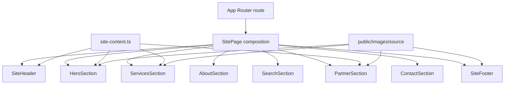
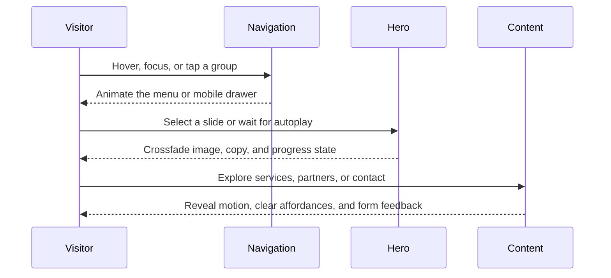

# Storyful Native Next.js Modernization

A polished, responsive rebuild of the Storyful homepage. The project keeps the recognizable editorial hierarchy and visual language of the source site while moving the experience into a maintainable Next.js application with local assets, deliberate motion, and a mobile-first system.

## What is included

- Native Next.js 16 App Router with a focused `src/` architecture
- Local Storyful photography, editorial graphics, favicon, and partner marks
- Responsive navigation with Framer Motion dropdowns and an accessible mobile drawer
- Motion-enabled hero carousel with autoplay, progress controls, and keyboard-safe buttons
- Subtle GPU lens treatment for depth without making the page dependent on WebGPU
- Service cards, process section, partner proof rail, contact form state, and responsive footer
- Strong contrast, semantic landmarks, reduced-motion support, and mobile layouts
- No iframe and no runtime dependency on the WordPress frontend

## Architecture



## Interaction model



## Scripts

| Script | Purpose |
| --- | --- |
| `npm run dev` | Start the local development server |
| `npm run build` | Create a production build |
| `npm run start` | Serve the production build |
| `npm run lint` | Run ESLint across the project |
| `npm run typecheck` | Run TypeScript without emitting files |

## Local development

```bash
npm install
npm run dev
```

Open `http://localhost:3000` to review the homepage.

## Deployment

The project is ready for Vercel:

```bash
npx vercel --prod
```

All visible page assets are served from the repository. External links are limited to intentional contact or partner destinations.
